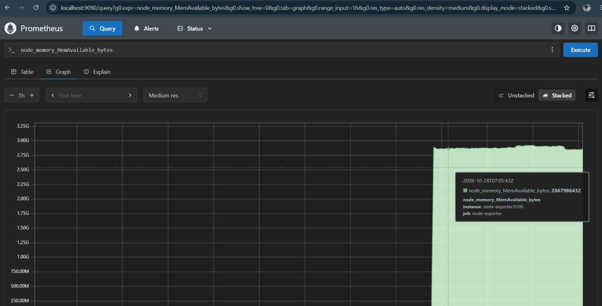
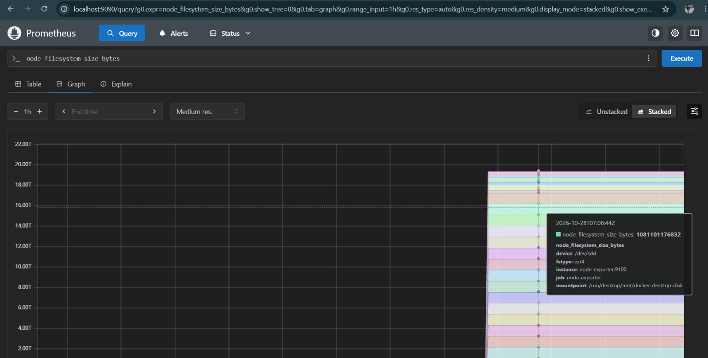
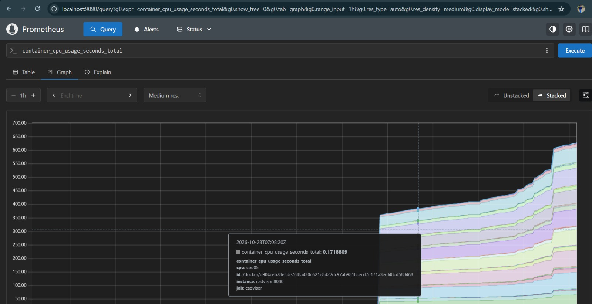
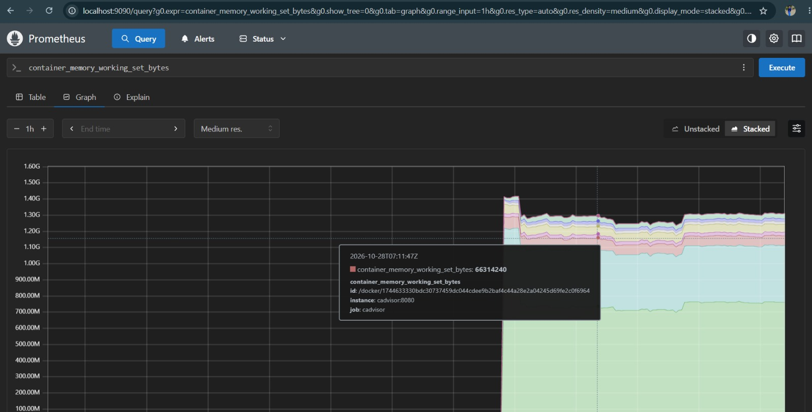
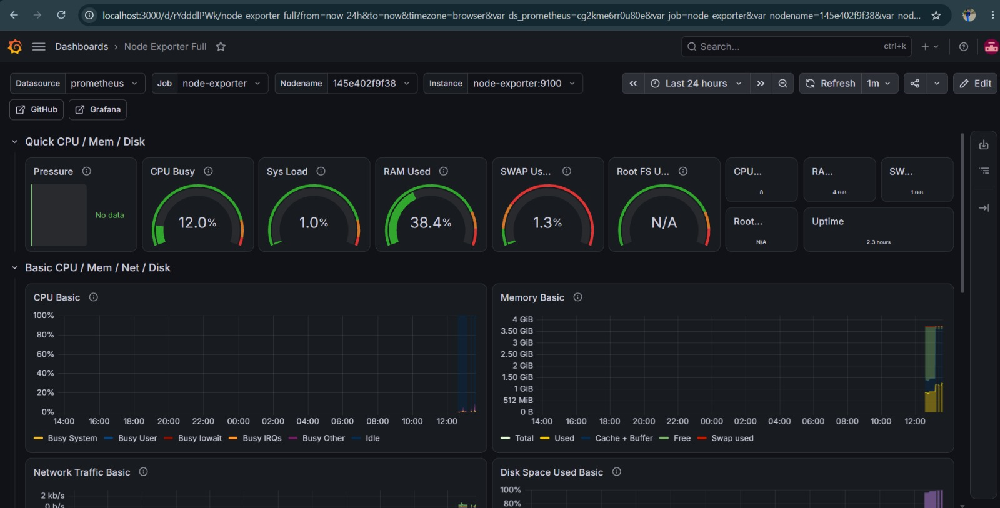
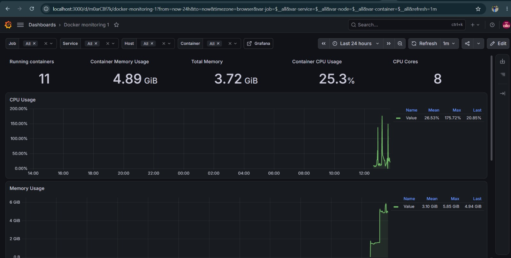

# Observability Stack

A Docker Compose observability stack for monitoring the Asset Tracker
application and the host running it. The stack uses:

- **Prometheus** for collecting and querying metrics
- **Node Exporter** for host-level metrics
- **cAdvisor** for Docker container metrics
- **Grafana** for dashboards and visualization
- **Loki** for storing and querying logs
- **Promtail** for collecting Docker container logs
- **OpenTelemetry Collector** for receiving and exporting telemetry

## Prerequisites

- [Docker Desktop](https://www.docker.com/products/docker-desktop/) with
  Docker Compose support
- Git
- Ports `3000`, `3100`, `4317`, `4318`, `5000`, `5173`, `8080`, `8889`,
  `9090`, and `9100` available on the host

## Project structure

```text
.
├── docker-compose.yml
├── prometheus.yml
├── alert-rules.yml
├── loki/
│   └── loki-config.yml
├── promtail/
│   └── promtail-config.yml
├── otel-collector/
│   └── otel-collector-config.yml
├── grafana/
│   └── provisioning/
│       └── datasources/
│           └── datasources.yml
└── README.md
```

## Configuration

Create a local `.env` file from `.env.example` and update the values where
needed. The `.env` file contains the database, application, and Grafana
settings used by Docker Compose.

```bash
copy .env.example .env
```

Do not commit `.env` because it can contain passwords and application secrets.

## Start the stack

Clone the repository and change into the project directory:

```bash
git clone https://github.com/vaishnavipawardottech/observability.git
cd observability
copy .env.example .env
```

Start all services in the background:

```bash
docker compose up -d
```

Check the service status:

```bash
docker compose ps
```

## Services

| Service | URL | Purpose |
| --- | --- | --- |
| Prometheus | <http://localhost:9090> | Collects and queries metrics |
| Node Exporter | <http://localhost:9100/metrics> | Exposes host metrics |
| cAdvisor | <http://localhost:8080> | Shows Docker container metrics |
| Grafana | <http://localhost:3000> | Visualizes metrics in dashboards |
| Loki | <http://localhost:3100> | Stores and queries logs |
| Promtail | <http://localhost:9080> | Collects Docker container logs |
| OpenTelemetry Collector | <http://localhost:4318> | Receives OTLP telemetry |

### Node Exporter: host metrics

Node Exporter exposes Linux host metrics such as CPU, memory, disk, filesystem,
and network usage. Its `/proc`, `/sys`, and root filesystem mounts are
read-only, so the exporter can collect metrics without modifying the host.

Node Exporter is configured as a Prometheus target in
[`prometheus.yml`](./prometheus.yml) using `node-exporter:9100`.

Open <http://localhost:9100/metrics> to verify that metrics are available.

Useful PromQL queries:

```promql
# CPU time by mode
node_cpu_seconds_total{mode="idle"}

# Memory usage percentage
(1 - node_memory_MemAvailable_bytes / node_memory_MemTotal_bytes) * 100

# Disk usage percentage for the root filesystem
(1 - node_filesystem_avail_bytes{mountpoint="/"} /
  node_filesystem_size_bytes{mountpoint="/"}) * 100

# Network receive rate
rate(node_network_receive_bytes_total[5m])
```

#### Some queries result:





### cAdvisor: container metrics

cAdvisor monitors Docker container resource usage and performance. It
collects container CPU, memory, filesystem, and network metrics.

The Docker socket, `/sys`, and Docker data directory are mounted read-only so
cAdvisor can discover containers and read their statistics.

cAdvisor is also configured as a Prometheus target using `cadvisor:8080`.
Open <http://localhost:8080> to view the cAdvisor interface.


Useful PromQL queries:

```promql
# CPU usage by container
rate(container_cpu_usage_seconds_total{name!=""}[5m])

# Memory usage by container
container_memory_usage_bytes{name!=""}

# Network receive rate by container
rate(container_network_receive_bytes_total{name!=""}[5m])

# Top three containers by memory usage
topk(3, container_memory_usage_bytes{name!=""})
```

The `{name!=""}` filter excludes aggregated entries and focuses on named
containers.

#### Some queries result





### Grafana: dashboards and visualization

Grafana provides dashboards for the metrics collected by Prometheus. The
Grafana service uses the `grafana_data` volume so dashboard data persists
when the container is recreated.

Open <http://localhost:3000> and sign in with the values configured in `.env`:

- Username: `grafyn_admin`
- Password: `grafyn_password`

The Prometheus and Loki datasources are provisioned automatically from
[`datasources.yml`](./grafana/provisioning/datasources/datasources.yml), so no
manual datasource setup is required. Grafana connects to Prometheus at
`http://prometheus:9090` and Loki at `http://loki:3100` through the Docker
Compose network.





### Loki and Promtail: container logs

Loki stores logs, while Promtail reads Docker's JSON log files and sends them
to Loki. Their configuration files are
[`loki/loki-config.yml`](./loki/loki-config.yml) and
[`promtail/promtail-config.yml`](./promtail/promtail-config.yml).

Loki stores data in the `loki_data` volume. Promtail stores its reading
position in the `promtail_positions` volume, so it can continue from the
correct place after a restart.

Start or restart the logging services:

```bash
docker compose up -d loki promtail
```

Verify that Loki is ready:

```bash
curl http://localhost:3100/ready
```

The response should be `ready`. Generate some application logs if needed:

```bash
curl http://localhost:5173
```

The Promtail configuration labels these logs with `job="docker"`. Open
**Grafana > Explore**, select **Loki**, and try these LogQL queries:

```logql
# Show all Docker container logs
{job="docker"}

# Show lines containing an error
{job="docker"} |= "error"

# Exclude health-check messages
{job="docker"} != "health"

# Find HTTP 4xx and 5xx status codes
{job="docker"} |~ "status=[45]\\d{2}"

# Count log lines over the last five minutes
count_over_time({job="docker"}[5m])
```

For the exercise, select **Last 1 hour** in Explore and use these queries:

```logql
# Find error logs
{job="docker"} |= "error"

# Count error lines per minute
count_over_time({job="docker"} |= "error" [1m])
```

### Correlate metrics and logs

You can view metrics and logs together in Grafana:

1. Open the dashboard created above and add a new panel.
2. Select **Loki** as the datasource and use `{job="docker"}`.
3. Choose the **Logs** visualization and title the panel **Container Logs**.
4. In **Explore**, use split view to compare a Prometheus query on one side
   with the Loki query `{job="docker"}` on the other.

For example, compare container CPU usage with the logs produced at the same
time:

```promql
rate(container_cpu_usage_seconds_total{name!=""}[5m])
```

### OpenTelemetry: telemetry collection

OpenTelemetry (OTEL) is a vendor-neutral framework for generating, collecting,
and exporting metrics, logs, and traces. It is not a storage backend. The
OpenTelemetry Collector receives telemetry, processes it in batches, and
exports it to the systems that store or visualize it.

The collector configuration is in
[`otel-collector/otel-collector-config.yml`](./otel-collector/otel-collector-config.yml):

- OTLP over gRPC is available on port `4317`.
- OTLP over HTTP is available on port `4318`.
- OTEL metrics are exported in Prometheus format on port `8889`.
- Traces and logs are printed by the debug exporter. They are not persisted
  until a backend such as Jaeger or Grafana Tempo is added.

The collector receives data through **receivers**, transforms it through
**processors**, and sends it through **exporters**. A distributed trace
represents one request across services; each step is a span with trace and
span IDs, timing, and attributes.

Start the collector with the rest of the stack:

```bash
docker compose up -d otel-collector
```

Confirm that the collector is running:

```bash
docker compose logs otel-collector
```

Prometheus scrapes the collector's metrics endpoint as the `otel-collector`
target. Check **Prometheus > Status > Targets** and confirm that it is **UP**.

#### Send test OTLP telemetry

The repository includes [`otel-test.py`](./otel-test.py), which sends one test
trace and a `test_requests_total` metric to the collector over OTLP/gRPC.
Install its Python packages, then run it from the repository root:

```bash
pip install opentelemetry-api opentelemetry-sdk opentelemetry-exporter-otlp-proto-grpc
python otel-test.py
```

Check the exported trace in the collector output:

```bash
docker compose logs otel-collector
```

Then query the metric in Prometheus:

```promql
test_requests_total
```

You can also send telemetry directly to the OTLP/HTTP endpoint at
`http://localhost:4318/v1/traces` or
`http://localhost:4318/v1/metrics`.

### Prometheus alerting

Prometheus loads the rules in
[`alert-rules.yml`](./alert-rules.yml). The rules detect high CPU usage, high
memory usage, high disk usage, and unavailable scrape targets.

To view the rules and their current state:

1. Open <http://localhost:9090>.
2. Select **Alerts** or go to **Status > Rules**.
3. Check whether each alert is **inactive**, **pending**, or **firing**.

Prometheus evaluates the rules every 15 seconds. The `for` value in each rule
sets how long its condition must remain true before the alert fires, which
helps avoid short-lived spikes.

Grafana can create additional dashboard alerts from Prometheus queries. Open
**Alerting > Alert rules > New alert rule**, choose a Prometheus query, set a
condition and evaluation interval, and configure a contact point such as
email or Slack.

## Observability architecture

The stack now covers metrics, logs, and traces:

```text
Node Exporter ──┐
cAdvisor ───────┼──> Prometheus ──> Grafana dashboards and alerts
OTEL Collector ─┘

Docker containers ──> Promtail ──> Loki ──> Grafana Explore and dashboards

Applications or OTLP clients ──> OTEL Collector ──> debug output
```

## Create a dashboard

To create a simple overview dashboard:

1. Open Grafana and select **Dashboards > New dashboard**.
2. Add a visualization and select the **Prometheus** datasource.
3. Add panels using the queries below.
4. Save the dashboard as **DevOps Observability Overview**.

### CPU usage

```promql
100 - (avg(rate(node_cpu_seconds_total{mode="idle"}[5m])) * 100)
```

Use a Gauge visualization with the title **CPU Usage %**.

### Memory usage

```promql
(1 - node_memory_MemAvailable_bytes / node_memory_MemTotal_bytes) * 100
```

Use a Gauge visualization with the title **Memory Usage %**.

### Container CPU usage

```promql
rate(container_cpu_usage_seconds_total{name!=""}[5m]) * 100
```

Use a Time series visualization and the title **Container CPU Usage**.

### Container memory usage

```promql
container_memory_usage_bytes{name!=""} / 1024 / 1024
```

Use a Bar chart visualization and the title **Container Memory (MB)**.

### Disk usage

```promql
(1 - node_filesystem_avail_bytes{mountpoint="/"} /
  node_filesystem_size_bytes{mountpoint="/"}) * 100
```

Use a Stat visualization with the title **Disk Usage %**.

## Verify Prometheus targets

1. Open <http://localhost:9090>.
2. Go to **Status > Targets**.
3. Confirm that `prometheus`, `node-exporter`, `cadvisor`, and
   `otel-collector` are **UP**.
4. Open **Graph** and run a PromQL query.

Prometheus scrapes the configured targets every 15 seconds. The target names
use Docker Compose service names because the services share the
`asset-tracker-network` network.

## Stop the stack

Stop the containers without removing persistent data:

```bash
docker compose down
```

To remove the containers and named volumes:

```bash
docker compose down -v
```

## Troubleshooting

View logs for a specific service:

```bash
docker compose logs -f prometheus
docker compose logs -f node-exporter
docker compose logs -f cadvisor
docker compose logs -f grafana
docker compose logs -f loki
docker compose logs -f promtail
docker compose logs -f otel-collector
```

If a target is not **UP**, confirm that all services are running with
`docker compose ps` and that the target uses the Compose service name rather
than `localhost`. If no logs appear in Grafana, check the Loki and Promtail
logs and confirm that Docker container log files are available to Promtail.
